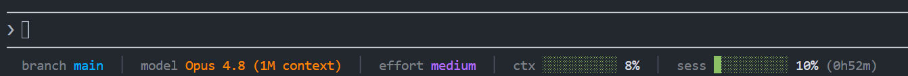

# Claude Code — Custom Statusline

A compact statusline for Claude Code with visual references:



```
branch main  │  model Opus 5.5  │  effort high  │  ctx ████░░░░░░ 42%  │  sess █░░░░░░░░░ 18% (1h01m)  │  week ████░░░░░░ 41% (3d04h)
```

## What it shows

| Field    | Color   | Source                                                                             |
|----------|---------|------------------------------------------------------------------------------------|
| `branch` | blue    | current git branch of the workspace                                                |
| `model`  | orange  | `model.display_name` from stdin JSON, followed by a yellow `fast` tag when `fast_mode` is on |
| `effort` | purple  | `effort.level` from stdin JSON (live value, including mid-session `/effort` changes); `-` when the model doesn't support effort |
| `ctx`    | bar+%   | `context_window.used_percentage`; `--` while Claude Code hasn't reported it yet     |
| `sess`   | bar+%+time | `rate_limits.five_hour.used_percentage`, followed by time left until the 5h window resets (`rate_limits.five_hour.resets_at`), formatted as `HhMMm` in dim grey — shows `--` when the data is missing |
| `week`   | bar+%+time | `rate_limits.seven_day.*`, same format (`XdYYh` when more than a day remains). Only shown when Claude Code sends it |

Bars are 10 cells wide (`█` filled / `░` empty) and change color by threshold:
- **green** if `<70%`
- **yellow** if `70–89%`
- **red** if `≥90%`

Labels (`branch`, `model`, `effort`, `ctx`, `sess`, `week`) are rendered in dim grey so they serve as visual references without competing with the values.

## Dependencies

- **`bash`** — native on macOS/Linux. On Windows it ships with [Git for Windows](https://git-scm.com/download/win) (Git Bash).
- **`jq`** — command-line JSON parser. The only thing likely to be missing:
  - macOS: `brew install jq`
  - Ubuntu/Debian: `sudo apt install jq`
  - Windows: `winget install jqlang.jq` *(or `choco install jq`)*, then restart Claude Code so it picks up the new `PATH`. Check with `jq --version` from Git Bash. If `jq` came bundled with another tool (Anaconda, for example), uninstalling that tool removes it too.

  If `jq` is missing, the statusline shows `statusline: falta jq (...)` instead of the fields.
- **`git`** — already installed if you are using Claude Code.
- **Terminal with UTF-8 + ANSI 256-color** — Windows Terminal, iTerm2, gnome-terminal, mintty. Any modern terminal works.

## Installation

### 1. Copy the script

Copy `bin/statusline-command.sh` to `~/.claude/statusline-command.sh`:

**macOS / Linux:**
```bash
cp bin/statusline-command.sh ~/.claude/statusline-command.sh
chmod +x ~/.claude/statusline-command.sh
```

**Windows (Git Bash):**
```bash
cp bin/statusline-command.sh ~/.claude/statusline-command.sh
```
*(On Windows you don't need `chmod` because the script is invoked via `bash` explicitly.)*

### 2. Configure `settings.json`

Edit `~/.claude/settings.json` (or create it if it doesn't exist) and add the `statusLine` block. The `command` value changes depending on the OS:

**macOS / Linux:**
```json
{
  "statusLine": {
    "type": "command",
    "command": "~/.claude/statusline-command.sh",
    "refreshInterval": 60
  }
}
```

`refreshInterval` (seconds) re-runs the script on a timer. Without it, the statusline only refreshes on session events, so the reset countdowns freeze while the session is idle.

**Windows (Git Bash):**
```json
{
  "statusLine": {
    "type": "command",
    "command": "bash /c/Users/<USERNAME>/.claude/statusline-command.sh",
    "refreshInterval": 60
  }
}
```

Replace `<USERNAME>` with your actual user. The `/c/Users/...` path is the MSYS/Git Bash format for `C:\Users\...` — Claude Code invokes the command via Git Bash and `~` sometimes doesn't expand correctly in that context.

**If `settings.json` already exists** with other fields (`model`, `effortLevel`, etc.), just add the `statusLine` block while keeping the rest:

```json
{
  "model": "opus",
  "effortLevel": "medium",
  "statusLine": {
    "type": "command",
    "command": "~/.claude/statusline-command.sh",
    "refreshInterval": 60
  }
}
```

### 3. Restart Claude Code

The statusline refreshes after every assistant response. Once you restart Claude Code it should already be visible.

## Try it before trusting it

To verify that `jq`, `git` and the script work without errors, simulate the JSON that Claude Code sends over stdin:

```bash
echo '{"workspace":{"current_dir":"'"$PWD"'"},"model":{"display_name":"Opus 5.5"},"effort":{"level":"high"},"context_window":{"used_percentage":42},"rate_limits":{"five_hour":{"used_percentage":18}}}' \
  | bash ~/.claude/statusline-command.sh
echo
```

Expected output (with real colors in a terminal):
```
branch main  │  model Opus 5.5  │  effort high  │  ctx ████░░░░░░ 42%  │  sess █░░░░░░░░░ 18% (--)
```

The trailing `(--)` is the time remaining until the 5h session window resets. It shows `--` here because the test JSON doesn't include `rate_limits.five_hour.resets_at`; in a real session you'll see something like `(4h12m)`.

If you see raw codes like `\033[38;5;39m`, the terminal isn't interpreting ANSI (unlikely in 2026, but possible in legacy `cmd.exe`).

## About the `effort` field

Claude Code sends the live reasoning effort in the stdin JSON as `effort.level` (`low`, `medium`, `high`, `xhigh` or `max`). It covers `/effort` changes mid-session, session-only values such as `/effort max`, and per-model defaults from `modelSettings`. The script displays it as-is.

The field is absent when the current model doesn't support the effort parameter; the statusline then shows `effort -`. Earlier versions of this script grepped the session transcript and fell back to `effortLevel` in `settings.json` (or `medium`), because Claude Code didn't expose the value back then. That is gone: it could show a stale value.

## Troubleshooting

| Symptom | Cause | Fix |
|---|---|---|
| `statusline: falta jq (...)` | `jq` not installed or not on `PATH` | Install `jq` with your OS package manager and restart Claude Code |
| `statusline skipped · restart to fix` | Workspace not trusted | Restart Claude Code and accept the trust dialog |
| Shows `branch -` | The cwd is not a git repo | Normal outside of repos; not an error |
| `sess -- (--)`, no `week` | Not a Claude.ai Pro/Max subscriber, or it's the first turn before the first API call | `rate_limits` only appears for subscribers after the first response |
| Countdown doesn't move | Statusline only re-runs on session events | Add `"refreshInterval": 60` to the `statusLine` block |
| Raw ANSI codes visible | Terminal isn't interpreting escape sequences | Use a modern terminal (Windows Terminal, iTerm2, etc.) |
| `effort -` | The current model doesn't support the effort parameter (`effort` absent from stdin JSON) | Expected; switch to a model that supports effort |

## Customization

Color codes are defined at the top of the script. To change them, edit these lines:

```bash
BR='\033[38;5;39m'   # blue   — branch
MD='\033[38;5;208m'  # orange — model
EF='\033[38;5;135m'  # purple — effort
```

The `\033[38;5;N m` codes are 256-color (N = 0-255). Reference table: [256 color cheatsheet](https://www.ditig.com/256-colors-cheat-sheet).

To change the bar width, modify `width=10` inside `build_bar()`.

To change the green/yellow/red thresholds, edit the `-ge 90` / `-ge 70` checks in `pct_color()` ("Color según umbral" section); `ctx`, `sess` and `week` all use it.

## Files in this directory

```
statusbar/
├── README.md                   ← this file
├── CLAUDE.md                   ← guidance for Claude Code contributors
├── bin/
│   └── statusline-command.sh   ← the script to copy to ~/.claude/
└── docs/
    ├── img.png                 ← preview screenshot used in this README
    └── statusline.md           ← upstream statusline reference (read-only)
```
